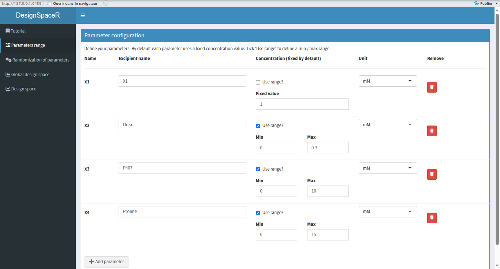
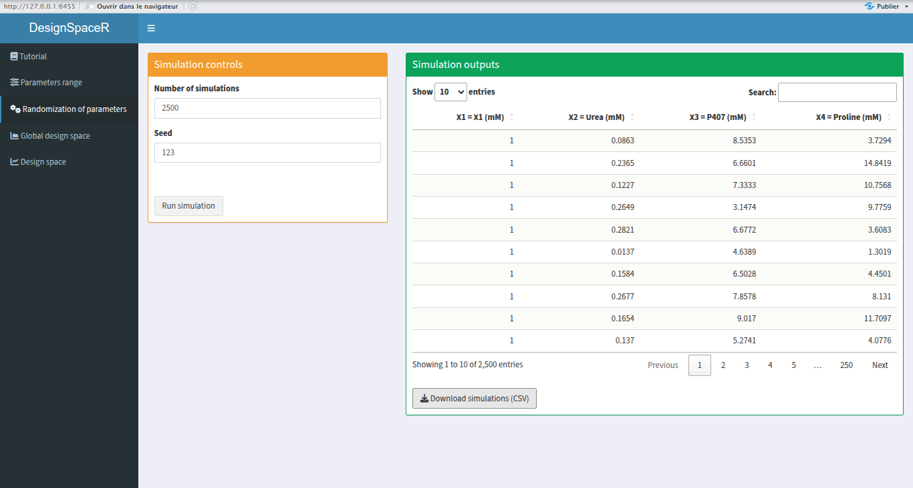
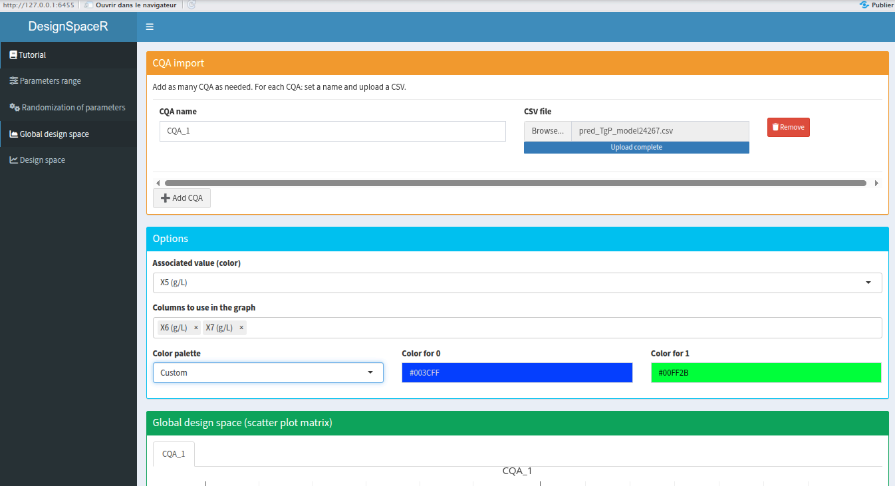
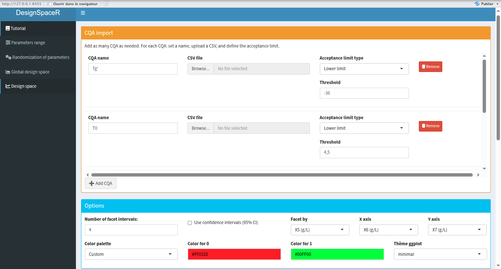
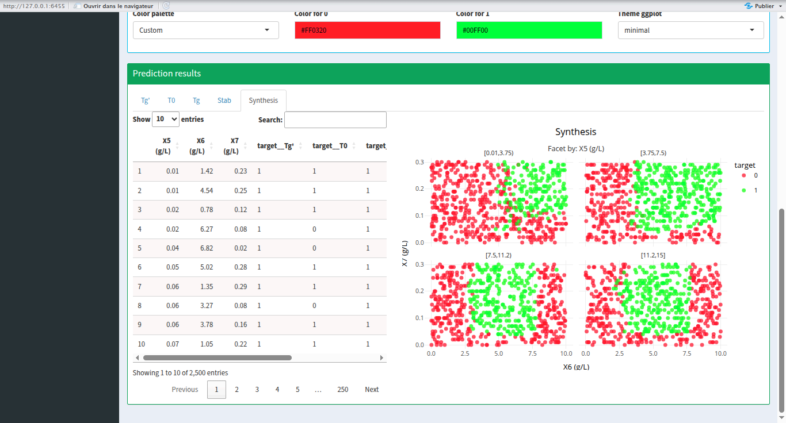

# 🧑‍💻 Author

**Richbenji**

---

# 📘 DesignSpaceR Tutorial

DesignSpaceR is a Shiny application designed to explore and visualize design spaces using simulated data and predictive models. It provides interactive tools to define parameters, run simulations, import CQA predictions, and visualize results using Plotly and ggplot2.

---

## 🧭 Navigation Overview

The app is organized into six main tabs:

1. **Parameters range** – Define excipients and their concentration ranges.
2. **Randomization of parameters** – Simulate combinations of parameters.
3. **Global design space** – Visualize CQA predictions using scatter plot matrices (SPLOM).
4. **Design space** – Visualize acceptability zones using faceted scatter plots.
5. **Summary** – Merge and summarize results.
6. **About** – Application metadata.

---

## ⚙️ 1. Parameters Range

### Purpose:
Define the excipients and their concentration values or ranges.

### Features:
- Add multiple excipients.
- Choose between fixed value or range (min/max).
- Specify units (`mM`, `mg/mL`).
- Remove excipients dynamically.

### UI Elements:
- `add_param` – Add a new excipient.
- `excipient_X` – Name of the excipient.
- `range_X` – Checkbox to use a range.
- `val_X`, `min_X`, `max_X` – Concentration values.
- `unit_X` – Unit selector.

---

## 🎲 2. Randomization of Parameters

### Purpose:
Generate simulated combinations of excipient concentrations.

### Features:
- Set number of simulations.
- Set random seed.
- View and download simulation results.

### UI Elements:
- `n_simu` – Number of simulations.
- `seed` – Random seed.
- `run_simu` – Run simulation.
- `table_sim` – Display results.
- `download_sim` – Export CSV.

---

## 🌐 3. Global Design Space

### Purpose:
Visualize CQA predictions using SPLOM (scatter plot matrix) with Plotly.

### Features:
- Import multiple CQA prediction files.
- Select columns to visualize.
- Choose color palette (continuous or custom).
- Customize colors for binary values (0/1).

### UI Elements:
- `add_cqa_pred_gd` – Add CQA.
- `cqa_name_gd_X` – CQA name.
- `cqa_file_gd_X` – Upload CSV.
- `color_var_gd` – Column used for coloring.
- `dims_gd` – Columns used in SPLOM.
- `palette_gd` – Color palette selector.
- `custom_color_0_gd`, `custom_color_1_gd` – Custom colors for 0 and 1.

### Color Palettes:
- Continuous palettes from Plotly: Viridis, Plasma, Cividis, etc.
- `"Custom"` option allows manual selection of red/green or user-defined colors.

---

## 📊 4. Design Space

### Purpose:
Visualize acceptability zones using faceted scatter plots with ggplot2.

### Features:

- Import multiple CQA prediction files.
- Define acceptance threshold and type (upper/lower).
- Use confidence intervals (CI).
- Select variables for X, Y, and faceting.
- Choose binary color palette.
- Customize ggplot theme.

### UI Elements:
- `add_cqa_pred` – Add CQA.
- `cqa_name_X`, `cqa_file_X` – CQA name and CSV.
- `cqa_limit_type_X`, `cqa_threshold_X` – Acceptance criteria.
- `use_ci` – Use 95% confidence interval.
- `facet_var`, `x_var`, `y_var` – Variable selectors.
- `palette_pred` – Binary color palette.
- `custom_color_0_pred`, `custom_color_1_pred` – Custom colors.
- `ggplot_theme` – ggplot theme selector.

### ggplot Themes:
- `minimal`, `classic`, `gray`, `bw`, `light`, `dark`, `void`

### Color Palettes:
- Binary palettes defined manually for each option.
- `"Custom"` allows user-defined red/green or other colors.

---

## 🎨 Color Palette Logic

### `get_palette(name)`
Returns the name of a Plotly continuous palette or `NULL` for `"Custom"`.

### `get_binary_colors(palette_name)`
Returns a named vector of colors for `"0"` and `"1"` values:
- Uses `input$custom_color_0_pred` and `input$custom_color_1_pred` if `"Custom"` is selected.
- Otherwise returns predefined hex codes for each palette.

---

## 🧱 Theme Logic

### `get_theme(theme_name)`
Returns a ggplot2 theme object based on user selection:
- `theme_minimal()`, `theme_classic()`, etc.
- Fallback to `theme_minimal()` if unknown.

---

## 🔄 Reactive Logic

- All UI inputs are linked to reactive values.
- CQA inputs are dynamically added/removed.
- Simulation and prediction results are updated based on user actions.
- Plotly and ggplotly outputs are rendered per CQA tab.

---

## 📁 File Format Requirements

- CSV files with headers.
- For prediction files: last two columns must be prediction and CI.
- Column `target` is computed based on threshold and CI.

---

## 🧪 Tips

- Always define at least two parameters to run simulations.
- Use `"Custom"` palette to manually control colors.
- Use `theme_void()` for minimalistic plots.
- Use `facet_var` to explore how predictions vary across conditions.

---

## 📌 Final Notes

DesignSpaceR is a modular and extensible tool for pharmaceutical design space exploration. It combines the power of Shiny, Plotly, and ggplot2 to deliver interactive and customizable visualizations.

